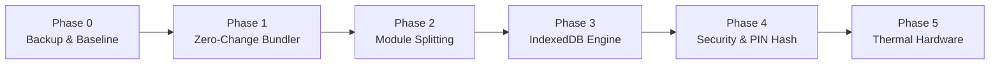

# NCS Accounts & POS: Phased Modernization Implementation Plan

> **Goal:** Safely transition the application from a single 332KB monolithic file into a high-performance, modular, IndexedDB-backed architecture with enhanced security and hardware integration.  
> **Budget Requirement:** **৳0 / $0 (100% Free & Open-Source)**  
> **Guiding Principle:** **Zero shop downtime, zero data loss risk, complete backward compatibility.**

---

## 1. Guiding Principles & Golden Rules

Before touching any code, all phases must adhere to the existing repository rules defined in `HANDOVER.md`:
1. **Never break money records:** Physical deletions are prohibited; soft flags (`void`, `del`, `removed`) must be preserved.
2. **One milestone per release:** Never combine architecture refactoring with new financial features.
3. **Always deliver complete runnable files:** No partial patches; the app must remain runnable offline at all times.
4. **Transparent Fallbacks:** Any new browser capability (e.g. IndexedDB, Web Bluetooth) must gracefully fall back to existing mechanisms (`localStorage`, standard print) if the user's browser or device does not support it.

---

## 2. Roadmap at a Glance



| Phase | Objective | Risk Level | Downtime | Tooling / Cost |
|---|---|---|---|---|
| **Phase 0** | Full disaster-recovery backup & beta validation | **Zero** | None | Free (Git / JSON) |
| **Phase 1** | Set up Vite + Single-File build pipeline (output identical to current `index.html`) | **Very Low** | None | Free (Vite / Node.js) |
| **Phase 2** | Decompose 332KB `index.html` into clean ES modules in `/src` | **Low** | None | Free (ES6 Modules) |
| **Phase 3** | IndexedDB migration with automatic `localStorage` dual-write & fallback | **Medium** | None | Free (`idb-keyval` / Native) |
| **Phase 4** | PIN security hashing (SHA-256) & AES-GCM encrypted backup download | **Low** | None | Free (Web Crypto API) |
| **Phase 5** | Direct Web Bluetooth / USB ESC/POS thermal printing & Year Archiving | **Low** | None | Free (Native Web APIs) |

---

## 3. Detailed Step-by-Step Execution Plan

---

### Phase 0: Backup & Baseline Validation (Day 1)
*Ensure 100% data safety before any structural code restructuring.*

1. **Full Disaster Recovery Snapshot:**
   - Export full JSON backup from the live app (`backupJson`).
   - Create a clean git checkpoint branch: `git checkout -b chore/modernization-baseline`.
2. **Verify Beta Prerequisites:**
   - Confirm `config.js` is clean (single `window.NCS_CONFIG` block).
   - Confirm `sync.js` wraps `window.save()` to trigger `schedulePush()`.
3. **Establish Regression Test Baselines:**
   - Document current startup time, memory footprint, and run the built-in self-test (`selfTest()`).

---

### Phase 1: Set Up Zero-Change Build Pipeline (Day 2)
*Introduce modern developer tooling without altering a single line of business logic.*

1. **Initialize Local Build Configuration:**
   - Add **Vite** and **`vite-plugin-singlefile`** as local dev-dependencies (`devDependencies`).
   - *Why?* This allows developers to work with clean separate files while compiling everything back into the exact single-file `index.html` that Electron, Capacitor, and the Service Worker expect.
2. **Verification Gate:**
   - Build the project (`npm run build`).
   - Verify that the compiled output is byte-compatible with the existing standalone `index.html` and that Electron and Android builds continue to function without any changes.

---

### Phase 2: Modular Source Extraction (Days 3 – 5)
*Break the 332KB monolith into manageable, domain-specific modules.*

```
Proposed /src Architecture:
src/
├── core/
│   ├── config.js         # Settings & environment constants
│   ├── state.js          # S object management & reactive save()
│   ├── sound.js          # Web Audio tone generation
│   ├── sync.js           # Delta sync engine
│   └── diag.js           # 200-event diagnostics ring buffer
├── modules/
│   ├── home/             # Dashboard cards & period aggregation
│   ├── pos/              # Barcode scanner, cart, hold bills, payUI
│   ├── products/         # Catalog, stock movements, cost tracking
│   ├── accounts/         # Cashbook, day close, void recovery
│   ├── ledger/           # Parties, WhatsApp dues, statement print
│   └── mgmt/             # Staff, PINs, review queue, wallet anchors
├── styles/               # CSS tokens, theme variables, print sheets
└── main.js               # Entry point & bottom bar tab routing
```

1. **Extraction Order:**
   - **Step 2.1:** Extract CSS tokens and stylesheets into `/src/styles/`.
   - **Step 2.2:** Extract `Sound`, `diag.js`, and `sync.js` into `/src/core/`.
   - **Step 2.3:** Extract `POS` closure and inventory logic into `/src/modules/pos/`.
   - **Step 2.4:** Extract `ledUI` and party statement logic into `/src/modules/ledger/`.
   - **Step 2.5:** Extract `mgmtUI` and security into `/src/modules/mgmt/`.
2. **Verification Gate:**
   - Run `selfTest()`.
   - Verify all 7 tabs load cleanly and all role restrictions (Admin, Accountant, Cashier, Keeper) remain intact.

---

### Phase 3: Storage Hardening — IndexedDB Migration (Days 6 – 8)
*Eliminate the 5MB localStorage crash hazard without risking existing records.*

1. **Implement Dual-Storage Adapter (`db.js`):**
   - Use a lightweight, zero-dependency async wrapper (like native IndexedDB or `idb-keyval`).
   - Keep fast session keys in `localStorage` (`theme`, `lang`, `sound`, `CUR`).
   - Route heavy financial arrays (`entries`, `bills`, `moves`, `cust`, `ltx`, `atts`) through IndexedDB.
2. **Transparent One-Time Migration Script:**
   - On app launch, check if IndexedDB is initialized.
   - If not, automatically read `ncs_accounts_v2` from `localStorage`, copy all records to IndexedDB, verify record counts, and mark migration complete.
3. **Safety Fallback:**
   - If IndexedDB fails or is blocked by private browsing mode, gracefully fall back to `localStorage`.
4. **Verification Gate:**
   - Test saving 500+ sample transactions. Ensure zero UI thread lag or freeze during checkout.

---

### Phase 4: Security Hardening (Days 9 – 10)
*Protect business data and credentials using native browser cryptography.*

1. **Cryptographic Staff PIN Hashing:**
   - Use the native `window.crypto.subtle` API.
   - Hash staff PINs using `SHA-256` with a unique shop salt:
     $$\text{Stored Hash} = \text{SHA-256}(\text{PIN} + \text{Salt})$$
   - Plaintext PINs are never stored in memory or persisted to disk.
2. **Password-Protected Backup Exports:**
   - Add an optional "Encrypt backup" checkbox on the JSON download dialog.
   - Uses AES-GCM (256-bit) to encrypt the exported file so it cannot be read if lost on a USB drive.
3. **Verification Gate:**
   - Verify PIN login across Admin, Cashier, and Accountant roles.

---

### Phase 5: Hardware Integration & Fiscal Year Archival (Days 11 – 13)
*Add retail-grade printing speed and long-term historical maintenance.*

1. **Direct ESC/POS Thermal Printing (Web Bluetooth / Web Serial):**
   - Connect directly to standard 58mm/80mm Bluetooth or USB thermal receipt printers.
   - 1-click instant printing without showing the browser print dialog popup.
   - Include automatic cash drawer kick code (`ESC p 0 25 250`).
2. **Fiscal Year-End Closing Utility:**
   - Add an Admin tool in Management: "Close Fiscal Year".
   - Archives completed years into a compressed backup table while carrying forward opening cash, wallet balances, and party dues into a clean active state.
3. **Verification Gate:**
   - Test receipt generation on actual thermal printer hardware; test balance roll-forwards.

---

## 4. Immediate Recommended Starting Step

To begin safely without risking daily shop operations:
1. **Approve Phase 0 & Phase 1:** Set up the modular build pipeline in a separate branch.
2. **Keep Production Untouched:** The live shop continues running on the current `index.html` (v10.0.0-beta) without interruption until the new build is tested and verified.

---

*Do you want to proceed with **Phase 0 (Disaster Backup & Git Baseline)** and **Phase 1 (Vite Single-File Setup)**?*
