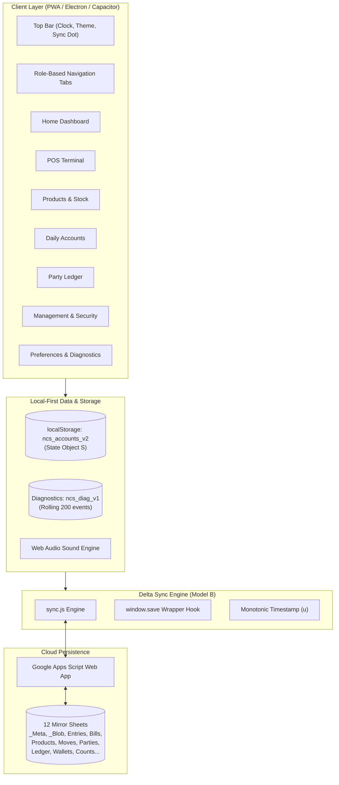

# NCS Daily Accounts & POS: Complete Application Reference & Strategic Improvement Roadmap

> **Target Version:** v10.0.0-beta (Cache `ncs-v53`)  
> **Application:** Nur Computer & Stationery (Daily Accounts, POS, Inventory, Multi-Party Ledger & Multi-Wallet)  
> **Runtime Environment:** Progressive Web App (PWA) / Electron / Capacitor Native Mobile & Desktop  

---

## Executive Summary

The **NCS Accounts** application is a tailored, offline-first retail ERP combining high-speed Point-of-Sale (POS) operations, double-entry daily cash bookkeeping, multi-party credit ledgers, multi-operator digital wallets (MFS & Recharge), and inventory stock accounting. 

This document serves as both a **definitive functional reference** of every tab, section, and system component, and an **actionable technical improvement plan** covering architecture, database scalability, security, and developer ergonomics.

---

## Part 1: Application Architecture & Core Systems



### 1. State Management & Data Collections
The entire runtime state is stored in a single object `S`, persisted directly to `localStorage` under `ncs_accounts_v2`:
- `entries`: Daily cash and account transactions.
- `bills`: Point-of-sale customer invoices and receipts.
- `products`: Product catalog with pricing, barcodes, and inventory thresholds.
- `moves`: Inventory stock movements (in, out, sale, restock, manual adjustment).
- `cust`: Counterparty profiles (Customers, Suppliers, Investors, Borrowers/Lenders).
- `ltx`: Ledger credit transactions and installments.
- `atts`: Attachment and receipt metadata.
- `walletDates`: Date-anchored opening balance resets for digital wallets.
- `counts`: Physical currency count records with denomination breakdowns.
- `days`: Day-closing status and locks (`closed: true/false`, timestamps).
- `users`: Staff credentials and role permissions.

### 2. Delta Synchronization Model (v10.0 Model B)
- **Engine (`sync.js`):** Implements delta push and pull over HTTPS to a Google Apps Script Web App.
- **Monotonic Timestamp (`u`):** Every modified record receives a high-resolution millisecond timestamp. Only records with `u > local_cursor` are pushed or pulled.
- **Conflict Strategy:** Last-Write-Wins (LWW) based on higher `u`.
- **Auto-Sync Trigger:** `sync.js` dynamically wraps `window.save()`. Every database mutation automatically invokes `schedulePush()`.
- **Hourly Snapshot:** Fallback complete JSON snapshots are archived in the `_Blob` sheet to guarantee disaster recovery.

### 3. Diagnostics & Telemetry (`diag.js`)
- Captures runtime unhandled promise rejections, JavaScript errors, network timeouts, and user workflows.
- Maintains a rolling ring buffer of the last 200 events in `localStorage` (`ncs_diag_v1`).
- Generates scrubbed, non-PII diagnostic reports exportable via text file, clipboard, or WhatsApp.

---

## Part 2: Comprehensive Breakdown of Tabs & Sections

```
┌────────────────────────────────────────────────────────────────────────┐
│                        TOP BAR & CONTROLS                              │
│ [Logo] Shop Name & Active Role │ Real-Time Clock │ Theme │ Sync Status │
└────────────────────────────────────────────────────────────────────────┘
│ Admin (7)      │ Home │ POS │ Products │ Accounts │ Ledger │ Manage │ More │
│ Accountant (4) │       │     │ Products │ Accounts │ Ledger │        │ More │
│ Cashier (3)    │       │ POS │          │          │ Ledger │        │ More │
│ Keeper (2)     │       │     │ Products │          │        │        │ More │
└────────────────┴───────┴─────┴──────────┴──────────┴────────┴────────┴──────┘
```

---

### Tab 1: Home Dashboard (`vHome`)
*Primary executive cockpit summarizing operations, cash positions, and period metrics.*

| Section / Component | Technical ID | Function & Operational Logic |
|---|---|---|
| **Period Selector** | `#hTabs` | Switches scope between Today, Yesterday, 7 Days, 1 Month, 3 Months, 6 Months, and Overall. |
| **Hero Cash Display** | `#hHero` | Real-time computed in-drawer cash balance (`calc()`). Features animated count-up (`animateCounts`). |
| **Operational Stat Cards** | `#hStats` | Displays Total Sales, Total Purchases, Number of POS Bills, To Receive (Due Sales), and To Give (Due Purchases). |
| **Stock Valuation Card** | `#hStats` | Computes $\sum (\text{Stock Qty} \times \text{Cost Price})$. Visible exclusively to Admin, Accountant, and Keeper. |
| **Cash In / Cash Out Flow** | `#hToday` | Three pills showing today's gross cash receipts, cash payouts, and net liquidity delta. |
| **MFS & Recharge Wallets** | `#wltWrapH` | Live balances across 4 MFS services (Bkash Personal, Nagad, Rocket, Bkash Agent) and 4 telecom recharge balances (GP, Robi/Airtel, Banglalink, Teletalk). |
| **Quick Action Shortcuts** | `#hQa` | Fast one-click dispatch to New Sale, New Purchase, Accounts Cashbook, or Today's Invoices. |
| **Comparative Analytics** | `#hChart`, `#hPay` | CSS-rendered charts illustrating 7-day sales vs. purchases and revenue breakdown by payment method. |
| **Recent Bills Feed** | `#hRecent` | Displays the 5 latest POS invoices with customer, invoice number, amount, and payment status. |

---

### Tab 2: Point of Sale Terminal (`vPos`)
*High-velocity billing engine supporting barcode scanning, discounts, and split payments.*

| Section / Component | Technical ID | Function & Operational Logic |
|---|---|---|
| **Mode Switcher** | `#mS`, `#mP` | Toggles terminal between **Customer Sale** and **Vendor Purchase/Restock**. |
| **Fast Search & Barcode** | `#q`, `#bScan` | Real-time text search and live camera barcode scanner (utilizing the device camera via BarcodeDetector API). |
| **Top 7 Favorites** | `#top7` | Quick-touch grid of the shop's top 7 best-selling products. |
| **Catalog Browser** | `#grid` | Categorized visual product selector with live stock indicators and stock-out alerts. |
| **Sale Cart Sidebar** | `.pos-cart` | Line items with unit pricing, quantity increment/decrement, and animated line removal. |
| **Dual Discount Engine** | `#dc`, `#dp` | Allows discounting either by exact Taka amount or by percentage (`%`) with `+` / `−` fine-tuning buttons. |
| **Hold / Park Cart** | `#bHold` | Temporarily shelves an active cart to `localStorage` (`D.held`) so another customer can be served. |
| **Custom Item Entry** | `#bCustom` | Allows one-off uncataloged items to be charged with custom description and price. |
| **Checkout & Receipt** | `#bPay`, `#fab` | Multi-method settlement dialog (Cash, MFS, Due). Generates 58mm/80mm thermal receipts with WhatsApp invoice sharing. |
| **Parked Bills Dialog** | `#bHeld` | Lists and recalls suspended bills back into the active cart. |
| **Bill Registry Dialog** | `#bBills` | Historical search, print duplicate receipt, or void/cancel invoices with mandatory audit reasons. |
| **Cash Drawer Utility** | `#bDrawer` | Physical drawer count helper validating cash inside the register. |

---

### Tab 3: Products & Stock Management (`vProd`)
*Inventory catalog, unit pricing, cost tracking, and stock movement logs.*

| Section / Component | Technical ID | Function & Operational Logic |
|---|---|---|
| **Inventory Metrics** | `#pdS` | Overview of Total SKUs, Low Stock alerts, Out-of-Stock warnings, and Total Inventory Value at Cost. |
| **Product Filter Tabs** | `#pdF` | Fast filters: **All Products**, **Low Stock** ($\le \text{alert threshold}$), and **Out of Stock** ($= 0$). |
| **Product Form Modal** | `pForm` | Add/Edit product title, category, barcode, retail price, cost price, and stock warning threshold. |
| **Stock Restock Modal** | `addStock` | Records incoming inventory batches, updating `S.moves` and adjusting weighted cost. |
| **Manual Stock Override** | `forceStock` | Physical stock correction tool. If initiated by non-admin staff, routes to Admin Review Queue. |
| **Safe Archival** | `npd` | Soft-deletes products (`del: 1`) to preserve historical invoice lines and reporting. |

---

### Tab 4: Daily Accounts Cashbook (`vAcc`)
*Double-entry daily bookkeeping tracking all cash, bank, and digital ledger entries.*

| Section / Component | Technical ID | Function & Operational Logic |
|---|---|---|
| **Day Navigation & Locks** | `#pd`, `#nd`, `#daybar` | Navigate historical dates. Displays Open/Closed state. Admin can close a day to prevent edits. |
| **Cash Position Header** | `#stats` | Opening Cash + Cash In − Cash Out = Closing Book Cash Balance. |
| **Wallet Running Badges** | `#wltWrap` | In-place view of all 8 digital wallet balances for the specific date. |
| **Cashbook Entry Form** | `#form` | Form capturing Time, Entry Type (Sale, Purchase, Deposit, Withdrawal, Adjustment), Category, Method, Wallet, Amount, and Party. |
| **Advanced Filter Suite** | `#fb` | Real-time filtering by description keyword, transaction type, payment channel, and date range. |
| **Audited Accounts Table** | `#tbl` | Formatted financial register with running balances, user authorship tags, edit, and void triggers. |
| **Voided Records Section** | `#avBar` | Audit drawer displaying cancelled entries with reasons and timestamps. Admins can execute restores. |
| **Cash Drawer Denomination Count** | `#cnt` | Modal for counting physical banknotes (৳1000 down to ৳1), comparing physical cash against book cash. |
| **Operational Footer Tools** | `.foot` | Single-click Undo (`#und`), Print-Ready Daily Accounts Sheet (`#prt`), and CSV Data Export (`#csv`). |

---

### Tab 5: Multi-Party Ledger (`vLed`)
*Customer, Supplier, Investor, and Loan/Borrowing account statements.*

| Section / Component | Technical ID | Function & Operational Logic |
|---|---|---|
| **Global Balance Metrics** | `.lsm` | Total Receivables (They Owe), Total Payables (We Owe), Net Exposure, and Borrow/Lend Balance. |
| **Party Classification Tabs** | `KT` | Filter parties by category: **Customers**, **Suppliers**, **Investors**, and **Borrowers/Lenders**. |
| **Status Segment Filters** | `F` | Segment accounts by: All, They Owe, We Owe, Settled, Flagged, Needs Check, and Archived. |
| **Ledger Statement View** | `ledProfile` | Date-filtered financial statement displaying running balance, debit/credit lines, and notes. |
| **Due Reminders Engine** | `dueNoticeText` | Generates polite, pre-formatted Bengali payment reminders with direct 1-tap WhatsApp and SMS links. |
| **Statement Print & Image** | `data-a="img"` | Exports statements as formatted PDFs or client-side Canvas images for mobile sharing. |
| **Cashbook Dual-Posting** | `ledForm` | When adding ledger collections/payments, an optional checkbox automatically creates the matching entry in Accounts. |
| **Party Archival** | `isA()` | Soft-archival of inactive counterparties preserving past transaction integrity. |

---

### Tab 6: Management & Security (`vMgmt`)
*Administrative console for system configuration, role access, and audit trails.*

| Section / Component | Technical ID | Function & Operational Logic |
|---|---|---|
| **Staff & Access Control** | `staffUI` | Manage personnel accounts, assign roles (Admin, Accountant, Cashier, Keeper), and update PINs. |
| **Settings & Security** | `$('set')` | Configure Google Apps Script Web App URL, secret tokens, and change master Admin PIN. |
| **System Change Log** | `$('logb')` | Rolling chronological log tracking every administrative action, price change, void, and permission override. |
| **Wallet Opening Anchors** | `openWltSettings` | Historical date-anchored wallet resets. Discrepancy detector alerts admins if recorded balance diverges from book total. |
| **Cash Count Log** | `cashCountHistory` | Permanent audit history of all physical currency note counts with variance calculations and user signatures. |
| **Admin Review Queue** | `reviewQueue` | Central inbox where Admin approves or rejects accountant edit requests and cashier stock adjustments. |
| **System Self-Test Suite** | `selfTest` | Automated in-browser test suite verifying mathematical models, storage quotas, and sync schema consistency. |
| **Force Logout All** | `rebootAsk` | Security kill-switch incrementing `S.rebootN`, instantly ending all active client sessions across terminals. |

---

### Tab 7: More Preferences & Utilities (`vMore`)
*Localization, audio feedback settings, and telemetry tools.*

| Section / Component | Technical ID | Function & Operational Logic |
|---|---|---|
| **Language Toggle** | `#lang` | Toggles application interface between **English** and **বাংলা (Bengali)**. |
| **Sound Effects Controller** | `#sndBtn` | Toggles Web Audio feedback (Cha-ching on sale, tick on navigation, buzz on error, chime on sync). |
| **Card Visibility Manager** | `#secCardBtn` | Admin settings panel enabling/disabling specific dashboard cards on Home and Accounts views. |
| **Beta Bug Reporter** | `#bugBtn` | Packages current system state and rolling 200 diagnostic events into an exportable bug report. |
| **Quick Screen Lock** | `#lockb` | Instantly locks terminal requiring PIN re-authentication. |

---

## Part 3: Strategic Engineering & Architectural Improvement Plan

While NCS Accounts is a fast, highly capable application, its current single-file monolithic structure and reliance on `localStorage` present clear scaling limits. Below is a structured engineering roadmap to transition the platform into an enterprise-grade retail system.

---

### Phase 1: Storage & Scalability Architecture (Critical Priority)

> [!WARNING]
> **Storage Quota Risk:** `localStorage` has a synchronous 5MB–10MB hard limit per origin. With high invoice volume, photo attachments (`atts`), and audit logs (`log`), the app will eventually hit quota failure and block saves.

1. **Migrate Core Storage to IndexedDB (Dexie.js / idb-keyval):**
   - Keep fast configuration parameters in `localStorage`.
   - Move large collections (`entries`, `bills`, `moves`, `ltx`, `atts`, `log`) into asynchronous **IndexedDB**.
   - Eliminates synchronous JSON serialization (`JSON.stringify(S)`) that blocks the main UI thread during sales.
2. **Implement Financial Year Partitioning & Archiving:**
   - Implement an automated year-end closing archive (e.g., `ncs_archive_2025`).
   - Active state only loads the current fiscal year, carrying forward opening balances.
   - Drastically cuts memory footprint on low-end mobile devices and POS terminals.
3. **Optimized Google Sheets Sync Cursors:**
   - Google Apps Script execution time is capped at 6 minutes.
   - Transition delta sync to strictly batch records in chunks of 100 with paging cursors to prevent HTTP timeout errors on slow connections.

---

### Phase 2: Codebase Modularization & Build Pipeline

> [!IMPORTANT]
> Currently, `index.html` is **330KB+** containing HTML, CSS, and 240+ global JavaScript functions in a single file. This creates high risk of regression bugs, prevents automated unit testing, and complicates multi-developer collaboration.

```
Proposed Modular Directory Structure:
├── src/
│   ├── core/
│   │   ├── db.js           # IndexedDB / LocalStorage adapter
│   │   ├── sync.js         # Delta sync engine
│   │   ├── sound.js        # Web Audio effects
│   │   └── diag.js         # Diagnostics logger
│   ├── modules/
│   │   ├── home/           # Dashboard cards and period calculations
│   │   ├── pos/            # Cart, scanning, and checkout logic
│   │   ├── products/       # Inventory, restock, and catalog
│   │   ├── accounts/       # Daily entries, cash reconciliation
│   │   ├── ledger/         # Parties, credit tracking, SMS notices
│   │   └── mgmt/           # Staff, PINs, review queue, audit logs
│   ├── styles/             # CSS tokens, theme variables, print sheets
│   └── main.js             # Bootstrap & routing
├── tests/                  # Automated unit and integration tests
├── vite.config.js          # Lightweight bundler producing single-file PWA output
```

- **Benefit:** Developers work in clean, modular ES modules while the build tool (Vite with `vite-plugin-singlefile`) compiles everything into the exact same portable, single-file offline distribution when needed.

---

### Phase 3: Security & Cryptographic Hardening

1. **Client-Side PIN Cryptographic Hashing:**
   - **Current State:** PINs are stored in plaintext or basic obfuscation inside `S.users`.
   - **Enhancement:** Hash PINs using standard Web Crypto API (`crypto.subtle.digest('SHA-256', pin + salt)`). Prevents shoulder-surfing or extraction via exported backups.
2. **Encrypted Offline Backups:**
   - Provide an optional password-protected AES-GCM encryption toggle when downloading JSON backups (`backupJson`), protecting sensitive business revenue data from unauthorized USB extraction.
3. **Tamper-Evident Ledger Audit Trail:**
   - Implement lightweight cryptographic chaining (hash chaining) on financial entries so that any manual alteration of past records outside the app is immediately flagged during the Self-Test.

---

### Phase 4: Operational & Hardware Ergonomics

1. **Direct Thermal Printer Support (Web Bluetooth & Web USB ESC/POS):**
   - Current printing relies on standard system print dialogs (`window.print()`).
   - Add direct ESC/POS byte-level thermal printer connectivity via Web Bluetooth and Web Serial. Enables instant 1-tap paper cutting and cash drawer ejection without opening system preview dialogs.
2. **Sub-Accounts Hierarchy (Roadmap v10.1.0):**
   - Implement parent-child account linking (e.g., Corporate client with multiple departmental branches), aggregating statements while maintaining separate billing accounts.
3. **Comprehensive Structured Loan Engine (Roadmap v10.2.0):**
   - Expand the Ledger Borrow/Lend module into a full amortization loan module supporting flat vs. reducing balance interest, scheduled installments, penalty tracking, and collateral documentation.

---

## Part 4: Quality Assurance & Testing Matrix

To guarantee financial calculation integrity across releases, the following automated test suite is recommended:

| Module | Test Case | Expected Behavior |
|---|---|---|
| **Accounts** | Daily Cash Balance Calculation | Verify `calc()` exactly balances: $\text{Opening} + \text{In} - \text{Out} \equiv \text{Closing}$. |
| **POS** | Dual Discount Calculations | Assert that percentage discount and flat discount never produce negative totals. |
| **Ledger** | Dual-Posting Reconciler | Verify that checking "Also record in cash" creates immutable linked entries with matching IDs. |
| **Wallets** | Date-Anchored Reset | Ensure running wallet balances re-anchor at specified dates without altering prior history. |
| **Delta Sync** | Bi-Directional Merge | Validate that concurrent edits on two devices resolve via last-write-wins (`u`) without duplicate rows. |

---

*Authored for Nur Computer & Stationery Development Team.*
